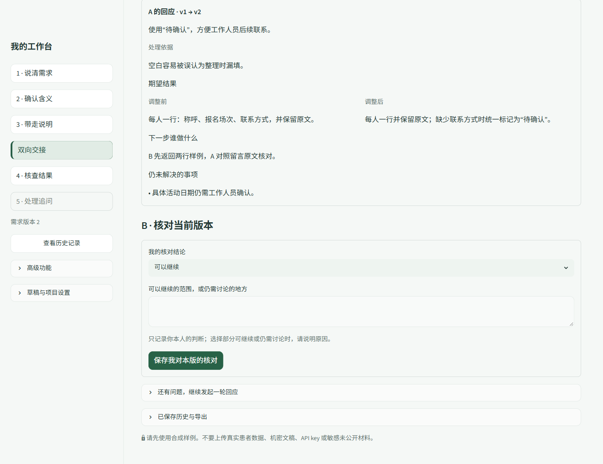

# ProblemBridge 工作台

[English](README.md) · [简体中文](README.zh-CN.md)

**说清需求，听到伙伴的回应，再一起核对调整结果。**

从一件具体工作开始，确认需求并形成交接说明。伙伴 B 写下理解与建议，领域参与者 A 回应并确认新版，B 再核对变化和待解决事项。

本地运行 · 中英双语 · 开始时无需 API key


## 三步开始使用

1. **说说你的工作。** 一次回答一个问题，暂时说不清的可以跳过。
2. **确认符合你的意思。** 修改表述、解释专业词语，写清怎样判断结果有用。
3. **带走两份说明。** 复制或下载，由你决定交给哪位合作者、放进哪个 AI。

有结果后，可按需使用 **ClaimHarness**，对照 CSV 表格核查可识别的英文数值表述。

## 走一遍双向交接

确认需求后，进入侧栏“双向交接”。同一台电脑或共享屏幕轮流操作即可；A、B 是操作者选择的角色。

| 谁来操作 | 做什么 | 留下什么 |
|---|---|---|
| B：技术协作者 | 复述理解，给出建议，提出问题 | B 的原话与待回应事项 |
| A：领域参与者 | 回应建议，调整或保留需求，说明原因 | 新版本、取舍与下一步 |
| B：技术协作者 | 对照变化，检查哪些问题仍未解决 | 可以继续／部分可以继续／仍需讨论 |

<a href="docs/figures/handoff-review-zh.png"></a>

实际程序截图，内容为合成演示。随后可带回一个小型文字或 CSV 样例，按选定要求保存人工检查；程序不会自动判断双方已经理解一致。

[完整操作说明](docs/two_way_handoff.md) · [交接流程图](docs/figures/two-way-handoff-zh.svg) · [单人第一轮测试](docs/first_round_single_participant.md) · [静态展示页源码](docs/static_showcase/zh-CN.html)

## 收到反馈或修改材料后继续

在已确认说明旁点击“和合作者完成一次双向交接”。B 直接记录理解与建议，A 回应并确认新版，B 再独立核对；随后可带回一个小样例，按已选要求保存人工检查。支持轮流操作、保存草稿、版本变化与待解决事项追溯。具体业务场景留待 formative 后确定。[双向交接操作与走查说明](docs/two_way_handoff.md)

在已确认说明旁选择“带回反馈继续讨论”，记录分歧、回答与更正，再由你确认新版说明。修改材料并重新核查后，可以比较两轮结果、补标遗漏表述，并分别保存程序结果、用户行动和人工意见。

运行完整合成示例：`python scripts/run_continuity_demo.py --out outputs/continuity_demo`。独立使用 ClaimHarness：`python -m streamlit run apps/claim_compare.py`。[使用流程、CLI 与记录格式](docs/continuous_review.md)

需要逐条跟踪关键要求时，可运行 `python -m problem_bridge requirements-demo --out outputs/requirements_demo`，打开输出中的 `workspace/review/requirement_trace.md`。这条 CLI 流程保留已选原话、确认版本、交接位置和注明来源的验收记录；验收记录独立于 ClaimHarness 判断。[选取、验收与改版说明](docs/requirement_traceability.md)

## 本地运行

原有 Agent 调用入口和可移植 skill 已补回，与双向交接原型共同保留：[skill 安装与用法](docs/agent_skills.md)、[问题与证据交接导出](docs/local_handoffs.md)、[原有功能对照与修复记录](docs/compatibility_check_2026-10-17.md)。

**Windows：** [下载源码 ZIP](https://github.com/RubyYii/ClaimHarness/archive/refs/heads/main.zip)，解压后双击 `RUN_PROBLEMBRIDGE_WINDOWS.bat`。

需要 Python 3.10–3.13。首次运行会安装依赖，并在浏览器打开本地页面 `http://127.0.0.1:8501`。

<details>
<summary>从终端安装与启动</summary>

在已激活的 Python 环境中，从仓库根目录运行：

```bash
python -m pip install -c requirements/constraints.txt -e ".[dev,ui]"
python -m streamlit run apps/problem_bridge_wizard.py
```

[环境设置与启动帮助](docs/reference.zh-CN.md#本地运行)

</details>

## 可执行的需求澄清示例

运行 `python -m problem_bridge clarify-demo --out outputs/clarification_demo --answer sensors`，查看合成需求如何经过执行预览、追问答复和任务修订，生成交接说明与 CSV 结果。加上 `--correct-to observations` 可演示用户显式修改要求。此本地示例没有模型调用或真人参与。

[机制说明、输出文件与 Python API](docs/clarification_mechanism.md)

## 使用边界

网页界面使用本地预设问题引导，由你确认专业含义；说明不会自动发送给他人或大模型。证据核查有明确范围，不能证明事实正确，也不能代替专业人员判断。

请先用公开或合成材料。不要输入真实患者数据、机密文稿或敏感未公开材料；分享项目文件夹前，请清除本地记忆。

## 进一步了解

- **使用工作台：** [中文指南](docs/reference.zh-CN.md) · [English guide](docs/reference.md)
- **了解能力范围：** [功能与限制](docs/limitations.md)
- **配置可选工具：** [模型设置](MODEL_PROVIDER_GUIDE.md) · [OCR](OCR_SETUP.md)
- **开发与项目资料：** [架构](docs/architecture.md) · [文档索引](docs/project_map.md)

<details>
<summary>命令行证据核查示例</summary>

安装后，在仓库根目录通过 PowerShell 运行：

```powershell
.venv\Scripts\python.exe -m claim_harness run `
  --manuscript examples/lab_report_audit_demo/manuscript.md `
  --tables examples/lab_report_audit_demo/tables `
  --references examples/lab_report_audit_demo/references.md `
  --out outputs/lab_report_audit_demo_run `
  --llm mock
```

主要输出：`claim_table.csv`、`evidence_map.json`、`audit_report.md`、`revision_suggestions.md`、`agent_trace.jsonl`。

重复运行时，请为 `--out` 指定新的文件夹。[核查演示](docs/demo_walkthrough.md) · [使用与技术参考](docs/reference.zh-CN.md)

</details>
